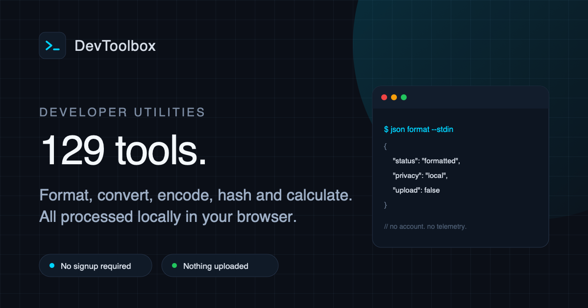
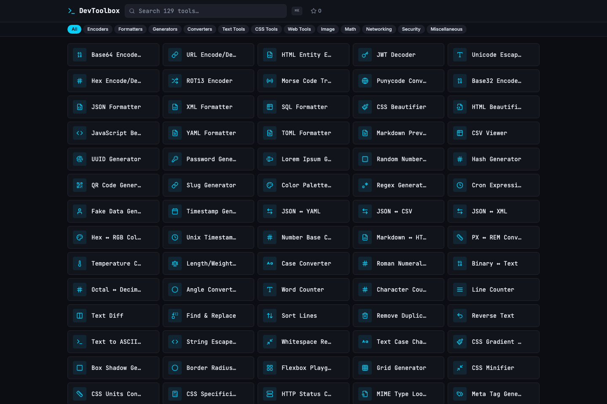
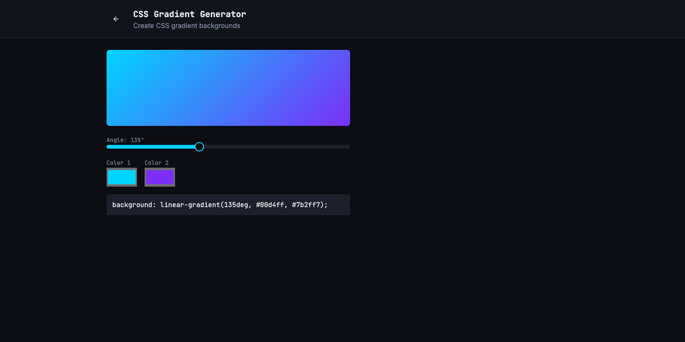
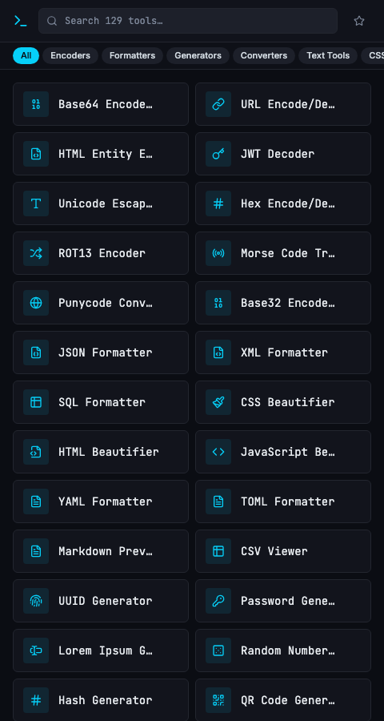

<div align="center">

# DevToolbox

**129 browser-based developer utilities in one fast, private, terminal-themed workspace.**

JSON, YAML, Base64, JWTs, regex, colors, CSS, cron, subnets, hashes and more. Everything runs locally in your browser — no uploads, no accounts, no telemetry.

[](https://github.com/askarthemasss/dev-essentials-hub/actions/workflows/ci.yml)
[](https://dev-essentials-hub.vercel.app)
[](LICENSE)
[](CONTRIBUTING.md)
[](.nvmrc)

[**Open the app**](https://dev-essentials-hub.vercel.app) · [Report a bug](https://github.com/askarthemasss/dev-essentials-hub/issues/new?template=bug_report.yml) · [Request a tool](https://github.com/askarthemasss/dev-essentials-hub/issues/new?template=feature_request.yml)



</div>

## Screenshots



<table>
  <tr>
    <td width="68%">
      
    </td>
    <td width="32%">
      
    </td>
  </tr>
  <tr>
    <td align="center"><sub>Live previews and copy-ready output, like this CSS gradient builder</sub></td>
    <td align="center"><sub>Dense, responsive layout that works on mobile</sub></td>
  </tr>
</table>

## Highlights

- **129 tools across 12 categories** — encoding, formatting, conversion, generation, CSS, security, networking, math and reference.
- **Instant search everywhere** — filter by name, description or category, or press <kbd>⌘</kbd>+<kbd>K</kbd> (<kbd>Ctrl</kbd>+<kbd>K</kbd>) to jump to any tool.
- **Personal dashboard** — favorites, recently used tools and most-used tools are stored locally.
- **Live previews** — gradients, shadows, flexbox, grids, clip paths, color palettes and more update as you type.
- **Private by design** — files, tokens, passwords and text never leave the page. There is no backend and no analytics.
- **Shareable, crawlable pages** — every tool has its own URL, static HTML metadata, canonical link, Open Graph tags and JSON-LD.
- **Fast by default** — the catalogue is static and every tool component is lazy-loaded on navigation.
- **Accessible UI** — labelled controls, keyboard navigation, visible focus states and responsive layouts.
- **Easy to extend** — add a catalogue entry plus one component file; the registry discovers it automatically.

## Tech stack

| Layer | Technology |
| --- | --- |
| UI | [React 18](https://react.dev) + [TypeScript 5](https://www.typescriptlang.org) |
| Build | [Vite 5](https://vite.dev) with SWC |
| Styling | [Tailwind CSS 3](https://tailwindcss.com) + CSS variables |
| Components | [shadcn/ui](https://ui.shadcn.com) + [Radix UI](https://www.radix-ui.com) primitives |
| Icons | [Lucide](https://lucide.dev) |
| Routing | [React Router 6](https://reactrouter.com) |
| Editors & data | `marked`, `turndown`, `yaml`, `papaparse`, `sql-formatter`, `dompurify`, `qrcode` |
| Testing | [Vitest 3](https://vitest.dev) + Testing Library + jsdom |
| Quality | ESLint 9 + TypeScript strict mode |
| CI/CD | GitHub Actions + Vercel |
| Fonts | Inter + JetBrains Mono |

No state-management library, database or API server — just React, local storage and browser APIs.

## Quick start

Requirements: **Node.js 20.19+** (Node 22 recommended, pinned in `.nvmrc`) and npm.

```sh
git clone https://github.com/askarthemasss/dev-essentials-hub.git
cd dev-essentials-hub
nvm use          # optional, uses Node 22
npm ci
npm run dev
```

Open [http://localhost:8080](http://localhost:8080).

### Scripts

| Command | Description |
| --- | --- |
| `npm run dev` | Start the Vite dev server on port 8080 |
| `npm run build` | Build the SPA, then generate per-tool SEO pages, sitemap, robots.txt and 404.html |
| `npm run preview` | Preview the production build locally |
| `npm run lint` | Run ESLint |
| `npm run typecheck` | Type-check the app |
| `npm test` | Run the Vitest suite once |
| `npm run test:watch` | Run Vitest in watch mode |

## Project structure

```text
src/
├── data/
│   ├── tools.ts              # catalogue: id, name, description, category, icon
│   └── toolRegistry.ts       # discovers tool components via import.meta.glob
├── components/
│   ├── tools/                # one lazy-loaded component per tool
│   ├── ui/                   # shadcn/ui primitives
│   ├── ToolCard.tsx
│   └── CommandPalette.tsx
├── hooks/                    # SEO, favorites, recents, most-used
├── lib/                      # pure logic + unit tests
└── pages/                    # home, tool page, 404
scripts/generate-seo.mjs      # static metadata, sitemap, robots.txt, 404.html
docs/screenshots/             # README screenshots
```

### Adding a tool

1. Add an entry to `src/data/tools.ts` with a unique `id`, `name`, `description`, `category` and Lucide `icon`.
2. Create `src/components/tools/<Name>Tool.tsx` exporting a default component. The filename is derived from the tool `id` by `src/data/toolRegistry.ts`.
3. Put non-trivial logic in `src/lib/` and add a Vitest test next to it.
4. Run `npm run typecheck`, `npm run lint`, `npm test` and `npm run build`.

Tool components only render their controls and output. `src/pages/ToolPage.tsx` wraps every component in `ToolLayout` and handles the title, description, lazy loading and SEO.

## All 129 tools

<details>
<summary><strong>Expand the full catalogue</strong></summary>

### Generators (21)

- [UUID Generator](https://dev-essentials-hub.vercel.app/tool/uuid-generator) — Generate random UUIDs (v4)
- [Password Generator](https://dev-essentials-hub.vercel.app/tool/password-generator) — Generate secure passwords
- [Lorem Ipsum Generator](https://dev-essentials-hub.vercel.app/tool/lorem-ipsum) — Generate placeholder text
- [Random Number Generator](https://dev-essentials-hub.vercel.app/tool/random-number) — Generate random numbers in range
- [Hash Generator](https://dev-essentials-hub.vercel.app/tool/hash-generator) — Generate SHA-1, SHA-256, SHA-384 and SHA-512 hashes
- [QR Code Generator](https://dev-essentials-hub.vercel.app/tool/qr-code) — Create QR codes from text/URLs
- [Slug Generator](https://dev-essentials-hub.vercel.app/tool/slug-generator) — Convert text to URL-friendly slugs
- [Color Palette Generator](https://dev-essentials-hub.vercel.app/tool/color-palette) — Generate color palettes
- [Regex Generator](https://dev-essentials-hub.vercel.app/tool/regex-generator) — Build regular expressions
- [Cron Expression Generator](https://dev-essentials-hub.vercel.app/tool/cron-generator) — Build cron schedule expressions
- [Fake Data Generator](https://dev-essentials-hub.vercel.app/tool/fake-data) — Generate fake names, emails, etc.
- [Timestamp Generator](https://dev-essentials-hub.vercel.app/tool/timestamp-generator) — Generate timestamps in formats
- [JSON Schema Generator](https://dev-essentials-hub.vercel.app/tool/json-schema) — Generate JSON Schema from JSON data
- [.gitignore Generator](https://dev-essentials-hub.vercel.app/tool/gitignore-gen) — Generate .gitignore for any stack
- [Markdown Table Generator](https://dev-essentials-hub.vercel.app/tool/md-table) — Create markdown tables visually
- [Docker Compose Generator](https://dev-essentials-hub.vercel.app/tool/docker-compose) — Generate docker-compose.yml files
- [Nginx Config Generator](https://dev-essentials-hub.vercel.app/tool/nginx-config) — Generate Nginx server configurations
- [.env File Generator](https://dev-essentials-hub.vercel.app/tool/env-generator) — Generate .env files from templates
- [GraphQL Schema Builder](https://dev-essentials-hub.vercel.app/tool/graphql-schema) — Build GraphQL schemas visually
- [API Mock Generator](https://dev-essentials-hub.vercel.app/tool/api-mock) — Generate mock API responses from schemas
- [Dockerfile Generator](https://dev-essentials-hub.vercel.app/tool/dockerfile-gen) — Generate Dockerfiles for any stack

### Converters (18)

- [JSON ↔ YAML](https://dev-essentials-hub.vercel.app/tool/json-yaml) — Convert between JSON and YAML
- [JSON ↔ CSV](https://dev-essentials-hub.vercel.app/tool/json-csv) — Convert between JSON and CSV
- [JSON ↔ XML](https://dev-essentials-hub.vercel.app/tool/json-xml) — Convert between JSON and XML
- [Hex ↔ RGB Color](https://dev-essentials-hub.vercel.app/tool/hex-rgb) — Convert hex colors to RGB and back
- [Unix Timestamp ↔ Date](https://dev-essentials-hub.vercel.app/tool/unix-timestamp) — Convert Unix timestamps to dates and back
- [Number Base Converter](https://dev-essentials-hub.vercel.app/tool/number-base) — Convert between binary, octal, decimal, hex
- [Markdown ↔ HTML](https://dev-essentials-hub.vercel.app/tool/markdown-html) — Convert Markdown to HTML and back
- [PX ↔ REM Converter](https://dev-essentials-hub.vercel.app/tool/px-rem) — Convert between pixels and rem units
- [Temperature Converter](https://dev-essentials-hub.vercel.app/tool/temperature) — Convert between °C, °F, K
- [Length/Weight/Volume](https://dev-essentials-hub.vercel.app/tool/length-weight) — Convert measurement units
- [Case Converter](https://dev-essentials-hub.vercel.app/tool/case-converter) — Convert camelCase, snake_case, kebab-case
- [Roman Numeral Converter](https://dev-essentials-hub.vercel.app/tool/roman-numeral) — Convert to/from Roman numerals
- [Binary ↔ Text](https://dev-essentials-hub.vercel.app/tool/binary-text) — Convert binary to text and back
- [Octal ↔ Decimal](https://dev-essentials-hub.vercel.app/tool/octal-decimal) — Convert between octal and decimal
- [Angle Converter](https://dev-essentials-hub.vercel.app/tool/angle-converter) — Convert degrees, radians, gradians
- [JSON Diff](https://dev-essentials-hub.vercel.app/tool/json-diff) — Compare two JSON objects visually
- [JSON to TypeScript](https://dev-essentials-hub.vercel.app/tool/json-to-ts) — Convert JSON to TypeScript interfaces
- [TOML ↔ INI Converter](https://dev-essentials-hub.vercel.app/tool/toml-ini) — Convert between TOML and INI formats

### Formatters (13)

- [JSON Formatter](https://dev-essentials-hub.vercel.app/tool/json-formatter) — Format and validate JSON data
- [XML Formatter](https://dev-essentials-hub.vercel.app/tool/xml-formatter) — Pretty-print XML documents
- [SQL Formatter](https://dev-essentials-hub.vercel.app/tool/sql-formatter) — Format SQL queries
- [CSS Beautifier](https://dev-essentials-hub.vercel.app/tool/css-beautifier) — Beautify CSS stylesheets
- [HTML Beautifier](https://dev-essentials-hub.vercel.app/tool/html-beautifier) — Format HTML markup
- [JavaScript Beautifier](https://dev-essentials-hub.vercel.app/tool/js-beautifier) — Beautify JavaScript code
- [YAML Formatter](https://dev-essentials-hub.vercel.app/tool/yaml-formatter) — Format YAML documents
- [TOML Formatter](https://dev-essentials-hub.vercel.app/tool/toml-formatter) — Format TOML config files
- [Markdown Preview](https://dev-essentials-hub.vercel.app/tool/markdown-preview) — Preview Markdown as HTML
- [CSV Viewer](https://dev-essentials-hub.vercel.app/tool/csv-viewer) — View CSV data in a table
- [JavaScript Minifier](https://dev-essentials-hub.vercel.app/tool/js-minifier) — Minify JavaScript code
- [HTML Minifier](https://dev-essentials-hub.vercel.app/tool/html-minifier) — Minify HTML markup
- [YAML Validator](https://dev-essentials-hub.vercel.app/tool/yaml-validator) — Validate YAML syntax with error details

### Encoders/Decoders (12)

- [Base64 Encode/Decode](https://dev-essentials-hub.vercel.app/tool/base64) — Encode or decode Base64 strings
- [URL Encode/Decode](https://dev-essentials-hub.vercel.app/tool/url-encode) — Encode or decode URL components
- [HTML Entity Encode/Decode](https://dev-essentials-hub.vercel.app/tool/html-entity) — Convert HTML entities
- [JWT Decoder](https://dev-essentials-hub.vercel.app/tool/jwt-decoder) — Decode and inspect JWT tokens
- [Unicode Escape/Unescape](https://dev-essentials-hub.vercel.app/tool/unicode-escape) — Escape or unescape Unicode characters
- [Hex Encode/Decode](https://dev-essentials-hub.vercel.app/tool/hex-encode) — Convert text to/from hexadecimal
- [ROT13 Encoder](https://dev-essentials-hub.vercel.app/tool/rot13) — Apply ROT13 cipher to text
- [Morse Code Translator](https://dev-essentials-hub.vercel.app/tool/morse-code) — Translate text to/from Morse code
- [Punycode Converter](https://dev-essentials-hub.vercel.app/tool/punycode) — Convert international domain names
- [Base32 Encode/Decode](https://dev-essentials-hub.vercel.app/tool/base32) — Encode or decode Base32 strings
- [Hex Dump Viewer](https://dev-essentials-hub.vercel.app/tool/hex-dump) — View text as hex dump output
- [Base58 Encode/Decode](https://dev-essentials-hub.vercel.app/tool/base58) — Encode or decode Base58 strings (Bitcoin)

### Text Tools (12)

- [Word Counter](https://dev-essentials-hub.vercel.app/tool/word-counter) — Count words, characters, sentences
- [Character Counter](https://dev-essentials-hub.vercel.app/tool/char-counter) — Count characters with/without spaces
- [Line Counter](https://dev-essentials-hub.vercel.app/tool/line-counter) — Count lines in text
- [Text Diff](https://dev-essentials-hub.vercel.app/tool/text-diff) — Compare two texts and show differences
- [Find & Replace](https://dev-essentials-hub.vercel.app/tool/find-replace) — Find and replace text patterns
- [Sort Lines](https://dev-essentials-hub.vercel.app/tool/sort-lines) — Sort lines alphabetically or numerically
- [Remove Duplicates](https://dev-essentials-hub.vercel.app/tool/remove-duplicates) — Remove duplicate lines from text
- [Reverse Text](https://dev-essentials-hub.vercel.app/tool/reverse-text) — Reverse characters or lines
- [Text to ASCII Art](https://dev-essentials-hub.vercel.app/tool/ascii-art) — Convert text into ASCII art
- [String Escape/Unescape](https://dev-essentials-hub.vercel.app/tool/string-escape) — Escape special characters in strings
- [Whitespace Remover](https://dev-essentials-hub.vercel.app/tool/whitespace-remover) — Remove extra whitespace
- [Text Case Changer](https://dev-essentials-hub.vercel.app/tool/text-case-changer) — Change text to upper, lower, title case

### CSS Tools (11)

- [CSS Gradient Generator](https://dev-essentials-hub.vercel.app/tool/css-gradient) — Create CSS gradient backgrounds
- [Box Shadow Generator](https://dev-essentials-hub.vercel.app/tool/box-shadow) — Generate CSS box-shadow values
- [Border Radius Preview](https://dev-essentials-hub.vercel.app/tool/border-radius) — Preview border-radius values
- [Flexbox Playground](https://dev-essentials-hub.vercel.app/tool/flexbox-playground) — Interactive flexbox layout builder
- [Grid Generator](https://dev-essentials-hub.vercel.app/tool/grid-generator) — Generate CSS grid layouts
- [CSS Minifier](https://dev-essentials-hub.vercel.app/tool/css-minifier) — Minify CSS stylesheets
- [CSS Units Converter](https://dev-essentials-hub.vercel.app/tool/css-units) — Convert between CSS units
- [CSS Specificity Calculator](https://dev-essentials-hub.vercel.app/tool/css-specificity) — Calculate CSS selector specificity
- [Color Contrast Checker](https://dev-essentials-hub.vercel.app/tool/color-contrast) — Check WCAG color contrast ratios
- [CSS Clip Path Generator](https://dev-essentials-hub.vercel.app/tool/css-clip-path) — Generate CSS clip-path shapes
- [Tailwind Class Converter](https://dev-essentials-hub.vercel.app/tool/tailwind-converter) — Convert CSS to Tailwind classes and vice versa

### Web Tools (9)

- [HTTP Status Codes](https://dev-essentials-hub.vercel.app/tool/http-status) — Reference for HTTP status codes
- [MIME Type Lookup](https://dev-essentials-hub.vercel.app/tool/mime-types) — Look up MIME types by extension
- [Meta Tag Generator](https://dev-essentials-hub.vercel.app/tool/meta-tag) — Generate HTML meta tags
- [Open Graph Preview](https://dev-essentials-hub.vercel.app/tool/og-preview) — Preview Open Graph meta tags
- [Robots.txt Generator](https://dev-essentials-hub.vercel.app/tool/robots-txt) — Generate robots.txt files
- [Sitemap Generator](https://dev-essentials-hub.vercel.app/tool/sitemap) — Generate XML sitemaps
- [Favicon Generator](https://dev-essentials-hub.vercel.app/tool/favicon) — Generate favicon markup
- [Viewport Size Checker](https://dev-essentials-hub.vercel.app/tool/viewport-checker) — Check current viewport dimensions
- [URL Parser](https://dev-essentials-hub.vercel.app/tool/url-parser) — Parse and inspect URL components

### Security (6)

- [Password Strength Checker](https://dev-essentials-hub.vercel.app/tool/password-strength) — Check password strength
- [CSP Header Generator](https://dev-essentials-hub.vercel.app/tool/csp-generator) — Generate Content Security Policy headers
- [CORS Header Helper](https://dev-essentials-hub.vercel.app/tool/cors-helper) — Configure CORS headers
- [HMAC Generator](https://dev-essentials-hub.vercel.app/tool/hmac-generator) — Generate HMAC signatures
- [Checksum Validator](https://dev-essentials-hub.vercel.app/tool/checksum-validator) — Validate file checksums
- [JWT Generator](https://dev-essentials-hub.vercel.app/tool/jwt-generator) — Create and sign JWT tokens

### Math/Calc (7)

- [Percentage Calculator](https://dev-essentials-hub.vercel.app/tool/percentage-calc) — Calculate percentages easily
- [Aspect Ratio Calculator](https://dev-essentials-hub.vercel.app/tool/aspect-ratio) — Calculate aspect ratios
- [Byte/Bit Calculator](https://dev-essentials-hub.vercel.app/tool/byte-calc) — Convert between bytes, KB, MB, GB
- [Scientific Calculator](https://dev-essentials-hub.vercel.app/tool/scientific-calc) — Full scientific calculator
- [Bitwise Calculator](https://dev-essentials-hub.vercel.app/tool/bitwise-calc) — Perform bitwise operations
- [Matrix Calculator](https://dev-essentials-hub.vercel.app/tool/matrix-calc) — Matrix operations and transformations
- [Timestamp Diff](https://dev-essentials-hub.vercel.app/tool/timestamp-diff) — Calculate difference between two dates

### Image/Media (6)

- [Image to Base64](https://dev-essentials-hub.vercel.app/tool/image-base64) — Convert images to Base64 strings
- [SVG to Data URI](https://dev-essentials-hub.vercel.app/tool/svg-data-uri) — Convert SVGs to data URIs
- [Color Picker](https://dev-essentials-hub.vercel.app/tool/color-picker) — Pick and convert colors
- [Image Dimension Viewer](https://dev-essentials-hub.vercel.app/tool/image-dimensions) — View image width and height
- [Placeholder Image](https://dev-essentials-hub.vercel.app/tool/placeholder-image) — Generate placeholder images
- [SVG Path Viewer](https://dev-essentials-hub.vercel.app/tool/svg-path-viewer) — Visualize SVG path data

### Networking (5)

- [IPv4/IPv6 Validator](https://dev-essentials-hub.vercel.app/tool/ip-validator) — Validate IP addresses
- [Subnet Calculator](https://dev-essentials-hub.vercel.app/tool/subnet-calc) — Calculate subnet masks and ranges
- [MAC Address Formatter](https://dev-essentials-hub.vercel.app/tool/mac-formatter) — Format MAC addresses
- [Port Number Reference](https://dev-essentials-hub.vercel.app/tool/port-reference) — Common port numbers reference
- [CIDR Calculator](https://dev-essentials-hub.vercel.app/tool/cidr-calc) — Calculate CIDR ranges

### Miscellaneous (9)

- [Keyboard Shortcuts](https://dev-essentials-hub.vercel.app/tool/keyboard-shortcuts) — Common keyboard shortcuts reference
- [Emoji Picker](https://dev-essentials-hub.vercel.app/tool/emoji-picker) — Search and copy emojis
- [ASCII Table](https://dev-essentials-hub.vercel.app/tool/ascii-table) — Full ASCII character reference
- [Git Cheatsheet](https://dev-essentials-hub.vercel.app/tool/git-cheatsheet) — Common Git commands reference
- [Regex Tester](https://dev-essentials-hub.vercel.app/tool/regex-tester) — Test regular expressions
- [Cron Schedule Viewer](https://dev-essentials-hub.vercel.app/tool/cron-viewer) — Visualize cron schedules
- [Chmod Calculator](https://dev-essentials-hub.vercel.app/tool/chmod-calc) — Calculate file permissions
- [JSON Path Evaluator](https://dev-essentials-hub.vercel.app/tool/jsonpath) — Evaluate JSONPath expressions
- [Regex Explainer](https://dev-essentials-hub.vercel.app/tool/regex-explainer) — Explain regex patterns in plain English

</details>

## Privacy

Every tool runs entirely in the browser. Inputs, uploaded files and generated secrets are processed with browser APIs (Web Crypto, Canvas, FileReader, Blob URLs) and are never sent to a server. Favorites, recents and usage counts live in `localStorage` and can be cleared by wiping site data.

## SEO and deployment

The app is a static Vite build and deploys to any static host. `npm run build` also runs `scripts/generate-seo.mjs`, which writes:

- `dist/tool/<id>/index.html` for all 129 tools with their own title, description, canonical URL, Open Graph/Twitter tags and JSON-LD.
- a rewritten home page with matching metadata.
- `dist/sitemap.xml`, `dist/robots.txt` and `dist/404.html`.

Set the canonical origin when deploying to a custom domain:

```sh
cp .env.example .env
# edit VITE_SITE_URL
npm run build
```

`VITE_SITE_URL` drives canonical links, Open Graph URLs, the sitemap and robots.txt. When unset, the build falls back to `VERCEL_PROJECT_PRODUCTION_URL` on Vercel and then to `https://dev-essentials-hub.vercel.app`. On hosts that do not rewrite unknown paths, configure a fallback to `index.html` so client-side routes resolve.

The production site is deployed from `main` through Vercel; every pull request gets a preview deployment.

## Contributing

Contributions are welcome — new tools, bug fixes, accessibility improvements, tests and documentation all count.

- Read [CONTRIBUTING.md](CONTRIBUTING.md) for setup, tool-authoring and PR guidelines.
- Follow the [Code of Conduct](CODE_OF_CONDUCT.md).
- Browse [good first issues](https://github.com/askarthemasss/dev-essentials-hub/labels/good%20first%20issue) or open a [tool request](https://github.com/askarthemasss/dev-essentials-hub/issues/new?template=feature_request.yml).
- Before opening a PR, run `npm run typecheck && npm run lint && npm test && npm run build`.

Please report security issues privately rather than in a public issue. See [CONTRIBUTING.md#reporting-security-issues](CONTRIBUTING.md#reporting-security-issues).

## License

Released under the [MIT License](LICENSE). You can use, modify and distribute this project, including commercially, with attribution.

<div align="center">
<sub>Built for developers who would rather not paste production data into a random website.</sub>
</div>
